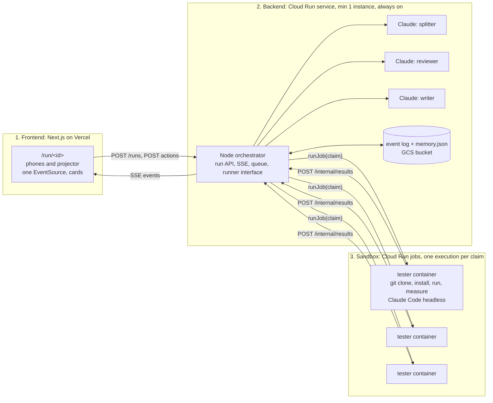

# README vs Reality

Moonfire Build Night, Thu 22 Oct 2026. Sparkles Cloud Crew track, built on Google Cloud. Team: Bergen, Allen, Akshay.

Someone in the room names a public GitHub repo. A crew reads the README, turns every claim into a test, runs each test in its own sandbox, rejects any verdict that has no run log, and ships a report card: claim by claim, pass or fail, with the commands and the log behind it. The run is a URL. Everyone's phone shows the same cards.

**Pitch line:** "Every README is a pitch deck. We put each claim in a clean sandbox and ran it."

## Why this one
- The sandbox is doing the thing it was built for: running a stranger's code. Not search and writing.
- Moonfire is a VC. This is technical diligence, and a startup could sell it to VCs (Sagar).
- Every line on screen has a log behind it and a reviewer that rejected the ones that didn't (Adriaan, Mike).
- No open-web dependency beyond cloning the repo and installing packages.

## The three parts



Loop on our side, sandboxes disposable. The backend holds every run; a sandbox holds nothing. Close every laptop and the Cloud Run service keeps draining the queue. That is the always-on claim, shown rather than said.

## The crew
1. **Splitter** (Claude call, backend): reads the README, returns up to 6 testable claims. Each claim: the README line it came from, the test to run, pass criteria.
2. **Testers** (one Cloud Run job execution per claim): clone, install, run, measure. Post `result.json` back: verdict, commands, exit codes, log tail, evidence.
3. **Reviewer** (Claude call, backend): rejects a verdict if the log is missing, the commands don't test the claim, or the pass criteria weren't met by what the log shows. One rerun per claim, then marked "unverified".
4. **Writer** (Claude call, backend): a short due-diligence report from accepted verdicts only.

Claims the splitter may make testable: installs in one command, tests pass, CLI runs with the documented flags, documented example works, "X times faster than Y" (benchmark both), supports language or runtime version Z, builds from source. Anything that needs a GPU, Docker-in-Docker, a paid API key or more than 3 minutes is tagged `untestable` and shown as such, not skipped.

## 1. Frontend (Bergen)
Next.js on Vercel. The browser talks straight to the Cloud Run URL (`NEXT_PUBLIC_API_URL`), so Vercel never holds a long-lived connection. One `EventSource`, resync on tab focus via `GET /runs/:id`. Dark, large type, readable from the back of the room and on a phone.
- `/`: one input, paste a GitHub URL, go.
- `/run/<id>`: repo name, stars, live score strip (pass / fail / unverified / testing). Claim cards stream in. Testing cards pulse. A rejected card shakes, shows the reviewer's reason, re-tests. Accepted cards go green or red.
- Tap a card: README line, commands, exit codes, log tail, reviewer note. That is the audit trail and the report.
- Presence chips. Token counter in the corner. `?stage=1` for the projector: QR, bigger cards, no drawer.

## 2. Backend (Allen builds, Akshay deploys)
One Node process (Hono or Express), container on Cloud Run, region `europe-west2`.

```
gcloud run deploy api --source ./backend --region europe-west2 \
  --min-instances 1 --max-instances 1 --no-cpu-throttling --timeout 3600 \
  --allow-unauthenticated \
  --set-secrets ANTHROPIC_API_KEY=anthropic-key:latest,INTERNAL_TOKEN=internal-token:latest
```

- `--max-instances 1` so in-memory state is the truth. `--no-cpu-throttling` so the queue drains between requests. `--min-instances 1` so it never sleeps.
- Every event appended to `gs://<bucket>/runs/<id>.jsonl`; replayed on boot. Firestore is the upgrade, named on the slide, not built.
- CORS open to the Vercel origin and localhost.
- Runner is an interface. Two implementations: `cloudrun` (the real one) and `local` (`claude -p` on a laptop, demo fallback). A `mock` runner emits a fixture so the frontend has events by 5:45.
- Dispatch via the Cloud Run Admin API (`@google-cloud/run`, `JobsClient.runJob` with container overrides for `RUN_ID`, `CLAIM_JSON`, `REPO_URL`). Not a `gcloud` shell-out.

### Run API
- `POST /runs` `{ repoUrl, by }` → `{ id }`
- `GET /runs/:id/events` → SSE, full replay then live, heartbeat comment every 30s
- `GET /runs/:id` → current state
- `POST /runs/:id/actions` `{ type, claimId, by }` → applied, broadcast. Types: `rerun`, `mark_unverified`, `pin`
- `POST /internal/results` `{ runId, claimId, result }` with `Authorization: Bearer INTERNAL_TOKEN`, called by testers

### Events
Every event `{ seq, ts, runId, type, ...payload }`. `seq` monotonic per run; clients drop anything already seen.

| type | payload | from |
|---|---|---|
| `run.created` | `repoUrl, by` | backend |
| `presence.join` / `presence.leave` | `name` | backend |
| `readme.loaded` | `lines, stars, language` | backend |
| `claim.added` | `claim: { id, text, readmeLine, test, criteria, testable }` | splitter |
| `claim.testing` | `claimId, executionId, runner` | backend |
| `claim.result` | `claimId, verdict: pass \| fail, commands[], exitCodes[], logTail, evidence, durationMs` | tester |
| `claim.rejected` | `claimId, reason, attempt` | reviewer |
| `claim.accepted` | `claimId` | reviewer |
| `claim.unverified` | `claimId, reason` | reviewer |
| `memory.hit` | `claimId, source: "previous run <id>" \| "install recipe"` | backend |
| `report.ready` | `markdown, score: { pass, fail, unverified }, tokens: { in, out, cacheRead }` | writer |

### Claim card
```json
{
  "id": "k_01",
  "text": "Installs with a single pip install",
  "readmeLine": 12,
  "test": "pip install . in a fresh venv, import the package",
  "criteria": "exit 0 and import succeeds",
  "testable": true,
  "status": "queued | testing | rejected | accepted | unverified",
  "verdict": null,
  "commands": [],
  "logTail": "",
  "attempts": 0,
  "memory": null
}
```

## 3. Sandbox (Akshay)
A Cloud Run job named `tester`. One execution per claim, parallel executions are independent, each dies when done.

- **Image:** `node:22` plus `git`, `python3`, `uv`, `pnpm`, `build-essential`, and `@anthropic-ai/claude-code`. Built once with `gcloud builds submit`, pushed to Artifact Registry.
- **Entrypoint:** clone `REPO_URL` into `/work`, run `claude -p "$TESTER_PROMPT" --allowedTools Bash,Read,Write --output-format json` with `CLAIM_JSON` in the prompt, then `curl -X POST $API_URL/internal/results` with `result.json` and the last 60 log lines plus any line matching `error|fail|traceback|exception`. Exit.
- **Job config:** `--task-timeout 600 --cpu 2 --memory 4Gi --max-retries 0 --set-secrets ANTHROPIC_API_KEY=anthropic-key:latest,INTERNAL_TOKEN=internal-token:latest --set-env-vars API_URL=<cloud run url>`.
- **Egress:** Cloud Run jobs have internet egress by default, so `git clone`, `pip install` and `npm install` work. First test at 5:00 proves it.
- **Service account:** the backend's account needs `roles/run.invoker` and `roles/run.developer` on the job.
- **Local fallback:** `runner/local.ts` runs the same entrypoint script on a laptop in a temp dir. Same `result.json`, same POST.

## Token optimisation and memory (Bergen)
Named in the pitch as "why this runs all night for the cost of a coffee".

**Tokens**
- Fixed system prompts and tool order on splitter, reviewer, writer and tester so prompt caching hits on every call. Read cache tokens from the API response; show the ratio on the report.
- README trimmed to the first 400 lines plus any heading containing install, usage, benchmark, test, quick start.
- Splitter capped at 6 claims. Reviewer sees `logTail` only, never the full log. Logs stay in the container.
- Model split: Sonnet for splitter, tester and writer; Opus for the reviewer only. Gemini 3.5 Flash on Vertex as the reviewer's second opinion if there is time: the checker is a different model family from the checked.
- Token counter on the run: in, out, cache reads. One number on screen at the end.

**Memory** (`memory.json` in the bucket, loaded into a short block in the backend prompts)
- Claim verdicts by `repo@commit + claim text`. Same repo named twice: the second run fills from memory instantly and only re-tests what changed.
- Install recipes by ecosystem, learned from accepted runs: "pnpm repos need corepack enable", "poetry repos: poetry install --no-root". The tester gets the matching recipes in its prompt.
- Rejection patterns from the reviewer, fed back to the tester prompt as "do not" lines. Three max, most recent.

## Responsibilities
| | Owns | Done means |
|---|---|---|
| **Bergen** | Next.js on Vercel, token optimisation, memory store, pitch and story, demo repo choice with Akshay | Phones and projector render the full fixture run by 6:15. Cache ratio and token count on screen. Second run of the same repo shows memory hits. Pitch rehearsed twice. |
| **Allen** | Backend code: run API, SSE, event log, queue, splitter, reviewer, writer, runner interface, `cloudrun` and `local` runners | Fixture run streams end to end by 5:45. Real claims from a real README by 6:30. Reviewer rejects a bad verdict live. |
| **Akshay** | GCP project, APIs, secrets, bucket, tester image and job, Cloud Run deploy of the backend, demo repos | One job execution returns `result.json` to the backend by 6:00. Four in parallel by 6:30. Backend live on a Cloud Run URL by 6:30. Three demo repos pass end to end by 7:00. |

Shared: this file is the contract. Change it by editing it and telling the other two. Pull before you start, push when a piece works.

## Timeline (shift by one hour if hacking starts at 6)
- 5:00 Akshay: log in, project, enable Run, Build, Artifact Registry, Secret Manager, Storage. Build the tester image, run one job by hand against a tiny repo, time it, prove egress. Allen: run API and mock runner. Bergen: Next.js skeleton on Vercel against a hand-written event file.
- 5:45 Fixture run streams to phones through a local backend. First integration point.
- 6:00 First real job result lands in the backend.
- 6:30 Backend on Cloud Run. First real README end to end. Memory and token counter in.
- 7:00 Three demo repos pass. Record the cleanest run as a backup video.
- 7:30 Code freeze. Rehearse twice, once with the backup video.
- 7:45 Start the showcase run so it is live on phones by 8:15.

## Demo (2:30)
- 0:00 "Every README is a pitch deck." Ask the room for a repo, or take the pre-picked one. URL and QR on screen.
- 0:20 Claims appear on every phone. Six cards, jobs spinning up.
- 0:45 First results. One card goes red: "README says tests pass. 3 of 41 failed. Log line 212."
- 1:10 Reviewer rejects a verdict live: "no run log, rerun". Card shakes, re-tests, comes back with a log.
- 1:40 Report on screen: score strip, token count, cache ratio. "Ran for 11p."
- 2:00 Paste the same repo again. Memory hits: cards fill instantly, only the changed claim re-tests. Close the laptop. Phones keep streaming from Cloud Run.
- 2:20 "This is technical diligence a VC pays an associate a day for. It runs itself."

## Demo repos (Akshay and Bergen, tested by 7:00)
Three plus a backup. Installs under 60s, tests under 2 min, README with at least 4 concrete claims, no GPU, no Docker. One must have a claim that honestly fails.

## Risks
- Job egress blocked or image build slow: the 5:00 test catches it; local runner is the fallback and the pitch says so.
- Install blows the demo window: pre-picked repos only, 3 minute cap per claim, `unverified` on timeout.
- Every claim passes and the demo is flat: pick a repo with one false claim.
- Reviewer never rejects: seed the fixture with a logless verdict so the gate fires on stage.
- Lab account dies at 48h: every deploy command lives in this repo so a redeploy is 5 minutes.
- Rules on pre-built code: everything written tonight, fixture data excepted. Confirm at 5:00.

## Judges
- Mike Arpaia (Moonfire, osquery): real orchestration, untrusted code in disposable containers, a queue, a gate.
- Adriaan Engelbrecht (Anthropic): audit trail per claim, reviewer rejection, untrusted repo treated as data.
- Sagar Gupta (Anthropic VC): a VC tool a startup could ship.
- Kimoon Kim (Google Cloud): Cloud Run service plus jobs, event log replay, Firestore and durable workflows named as the production path.
