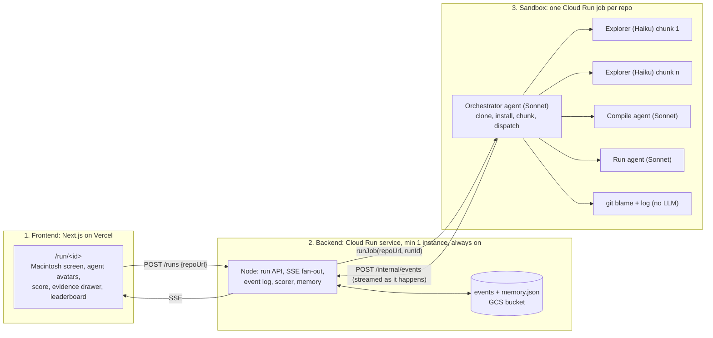

# README vs Reality: a technical due-diligence score out of 100

Moonfire Build Night, Thu 22 Oct 2026. Sparkles Cloud Crew track, built on Google Cloud. Team: Bergen, Allen, Akshay.

Paste a GitHub URL. A crew clones it into a sandbox, splits the codebase into chunks, explores every chunk with a cheap fast agent, compiles it, runs it, checks what the README claims against what was delivered, and returns a score out of 100 with the evidence behind every point: file, line, quote. A leaderboard shows who wrote what. On screen you watch the agents spawn and work, not code scrolling past.

**Pitch line:** "Every README is a pitch deck. We read the code, built it, ran it, and scored it."

## Tiers: what ships by 8pm
- **Core (must):** sandbox per repo, orchestrator sets it up, chunked exploration agents, rubric score out of 100 with quoted evidence, README delivered-vs-claimed count, compile agent, run agent, live avatar screen on phones and projector.
- **Stretch (if core is green by 7:00):** contributor leaderboard from git blame, classifier pass on findings, repo-type detection choosing the run agent.
- **Cherry (only if stretch is green by 7:20):** screenshot of the running app from a headless browser in the sandbox, used as the world the avatars fly over.

Anything below core that is not done by 7:30 is named in the pitch as next, not faked.

## The three parts



One container per run, agents inside it. The orchestrator streams events to the backend as they happen, so the screen moves while the job runs. The backend holds state; the container holds nothing after it exits. Close every laptop and the Cloud Run service keeps serving the run.

## 3. Sandbox: the crew (Akshay owns the container and the job, Allen owns the agent code)
Built on the Claude Agent SDK (Python) inside the container. One process, subagents in parallel, static system prompts so caching hits.

**Orchestrator (Sonnet 5.5).** Receives `REPO_URL`. Steps, each emitted as an event:
1. `git clone --depth 50` (depth 50 keeps blame useful, not full history).
2. Detect type: language mix from file extensions, package manager from lockfiles, `Dockerfile`, `package.json` scripts, framework markers (`next.config`, `manage.py`, `Cargo.toml`, `go.mod`). Emits `repo.profile`.
3. Install with the detected manager. Timeout 3 min. Failure is a finding, not a crash.
4. Chunk the codebase (below). Emits `chunk.created` per chunk.
5. Dispatch explorers, compile agent, run agent, git stats in parallel. Cap 8 explorers at once.
6. Collect findings, hand them to the backend scorer. Emits `run.done`.

**Chunking (handles large codebases).** `git ls-files`, drop vendored and generated paths (`node_modules`, `vendor`, `dist`, `build`, `*.min.*`, `*.lock`, `*.generated.*`, images, binaries), drop files over 200KB. Group by top-level directory, then split any group over 40 files or 150KB into pieces. Cap at 24 chunks; above that, rank by git churn (commits touching the path in the last year) and explore the top 24, mark the rest `sampled`. Monorepo: each package is its own group. No README: claims dimension scored 0 with the note "no claims to check".

**Explorer (Haiku 5.5, one per chunk).** Gets: the chunk's file list, the repo profile, the rubric. Reads the files. Returns `findings[]` only, nothing else, in this fixed shape:
```json
{ "dimension": "dead_code | architecture | quality | tests | security | docs",
  "severity": "good | minor | major",
  "file": "src/api/auth.ts", "line": 42,
  "quote": "the exact lines, max 3",
  "note": "one sentence on why this matters" }
```
No prose, no score. The score is computed, never asked for.

**Claims agent (Haiku 5.5).** Reads the README. Lists every feature claim as one line. For each, searches the chunks' file lists and asks the relevant explorer's findings whether it exists. Returns `claims[]`: `{ text, readmeLine, status: delivered | partial | missing, evidenceFile, quality: 1-5, note }`. The quantitative number ("9 of 12 delivered") and the qualitative one ("delivered but untested") both come from here.

**Compile agent (Sonnet 5.5).** Runs the build (`npm run build`, `cargo build`, `go build`, `python -m compileall`, whatever the profile says). Returns `{ compiles, durationMs, buildSizeBytes, warnings, errorsTail }`.

**Run agent (Sonnet 5.5).** Depends on repo type:
- CLI or library: run the documented example from the README, run the test suite, capture pass and fail counts.
- API server: start it, hit the documented endpoints with curl, record status codes.
- Website: start the dev server, `curl` the root for a 200. Stretch: Playwright in the container takes a screenshot and posts it as `app.screenshot`. Cherry: a computer-use pass clicking the documented flow.
Returns `{ runs, testsPassed, testsFailed, endpointsOk, screenshotUrl, errorsTail }`. Hard cap 3 min.

**Git stats (no LLM).** `git shortlog -sne`, and per chunk `git blame --line-porcelain | grep author` counted. Returns authors with surviving lines per chunk and commit counts. Bots (`dependabot`, `[bot]`) dropped. Forks flagged if `git log` shows the upstream.

**Classifier pass (stretch, Haiku 5.5 with structured output).** Every finding re-labelled by a second cheap call that only outputs `{dimension, severity}` from the fixed enums, plus `valid: true|false` if the quote does not support the note. Disagreements with the explorer drop the finding. This is the "testable review framework": the taxonomy is fixed, the labels are checkable, and a bad finding is caught by a model that never saw the explorer's reasoning.

## 2. Backend: the scorer (Allen)
Node on Cloud Run. Same run API as before, plus the scorer. The sandbox never emits a score; the backend computes it from findings, so the number is reproducible and every point traces to an event.

**Rubric, 100 points.**
| Dimension | Points | Computed from |
|---|---|---|
| Delivered vs claimed | 25 | delivered / total claims × 15, plus mean quality × 2 |
| Runs | 15 | starts: 5, tests pass rate × 10 (no tests: 3) |
| Compiles | 10 | compiles: 7, no warnings: 3 |
| Code quality | 15 | 15 minus major findings × 2 minus minor × 0.5, floor 0 |
| Architecture | 10 | mean of explorer good minus major, scaled |
| Tests | 10 | test files present: 4, pass rate: 6 |
| Dead code | 5 | 5 minus dead-code majors |
| Security and docs | 10 | 5 each, same rule as quality |

Every dimension on the report shows its points and the three findings that moved it most, with file, line and quote. The qualitative read is the writer (Sonnet) turning accepted findings into eight sentences, one per dimension, each citing a file. It may not introduce a claim without a finding.

**Memory.** `memory.json` in the bucket: scores and findings by `repo@commit`, install recipes by ecosystem learned from successful installs, and the last three explorer mistakes the classifier caught, fed back as "do not" lines. Same repo twice: instant fill from memory, only changed chunks re-explored.

**Run API.** `POST /runs {repoUrl, by}` → `{id}`. `GET /runs/:id/events` SSE with replay. `GET /runs/:id` state. `POST /runs/:id/actions {type, by}` with `rerun_chunk`, `pin`. `POST /internal/events` from the sandbox with `INTERNAL_TOKEN`.

**Events** (`{seq, ts, runId, type, ...}`): `run.created`, `presence.join`, `repo.profile`, `install.done`, `chunk.created`, `agent.spawned {agentId, role, chunkId, model}`, `agent.working {agentId, file}`, `finding.added`, `claim.added`, `compile.done`, `run.done` (the run agent), `app.screenshot`, `contributors`, `score.updated {dimension, points}`, `report.ready {score, markdown, tokens}`, `agent.done`, `run.finished`.

**Deploy.** `gcloud run deploy api --source ./backend --region europe-west2 --min-instances 1 --max-instances 1 --no-cpu-throttling --timeout 3600 --allow-unauthenticated --set-secrets ANTHROPIC_API_KEY=anthropic-key:latest,INTERNAL_TOKEN=internal-token:latest`. Events mirrored to `gs://<bucket>/runs/<id>.jsonl`, replayed on boot.

## 1. Frontend (Bergen)
Next.js on Vercel, browser talks straight to the Cloud Run URL over one `EventSource`, resync on focus.

- `/`: one input, a GitHub URL, go.
- `/run/<id>`: an old Macintosh screen fills the view. The orchestrator avatar appears first. Every `agent.spawned` adds an avatar that flies to its chunk; `agent.working` moves it between files; `finding.added` pops a speech bubble with the quote. The world the avatars fly over is a treemap of the repo built from `chunk.created` (one tile per chunk, sized by files). When `app.screenshot` arrives, the treemap fades and the screenshot becomes the world. That is the generalisation: every repo gets the treemap, web repos get the real thing.
- Score dial fills as `score.updated` events land. Tap a dimension: the findings that moved it, file, line, quote.
- Leaderboard panel from `contributors`: surviving lines per person per chunk, with that chunk's quality.
- Presence chips, token counter, `?stage=1` for the projector with the QR.
- Built against a fixture event file first; the fixture is the demo fallback.

## Models
Sonnet 5.5 for the orchestrator, compile, run and writer. Haiku 5.5 for explorers, the claims agent and the classifier: fast and cheap is the point with 24 chunks in flight. Opus nowhere tonight. The very fast hosts (Groq, Cerebras) do not serve Claude, so no.

## Edge cases, decided
- Huge repo: churn-ranked top 24 chunks, rest marked sampled, score shows the coverage.
- Install needs secrets or Docker: install marked blocked, Runs and Compiles score from what could be done, finding says why.
- No tests, no build system: those dimensions score their floor with a note, not zero.
- Multi-language: profile lists all, compile and run use the dominant one.
- Fork or squashed history: leaderboard shows "history truncated" instead of a bad ranking.
- Explorer hallucinates a file: backend checks every `file` against `git ls-files` from `repo.profile` and drops the finding. Cheap and it catches the worst failure.
- Sandbox times out (10 min): backend scores whatever landed, marks the run partial.

## Responsibilities
| | Owns | Done means |
|---|---|---|
| **Bergen** | Next.js on Vercel, avatar screen, treemap, score dial, evidence drawer, leaderboard, token counter, memory, pitch | Fixture run animates end to end on phones by 6:15. Real run by 7:00. Pitch rehearsed twice. |
| **Allen** | Agent code in the sandbox (orchestrator, explorers, claims, compile, run, git stats) and the backend scorer, run API, SSE, event log | Agents stream events from a local run by 6:00. Score computed from real findings by 6:45. Classifier if time. |
| **Akshay** | GCP project, APIs, secrets, bucket, sandbox image and job, backend deploy, repo-type detection, run agent per type, demo repos | One job runs a tiny repo end to end and posts events by 6:00. Backend on Cloud Run by 6:30. Three demo repos (one CLI, one API, one website) green by 7:00. |

Shared: this file is the contract. Pull before you start, push when a piece works.

## Timeline (shift by one hour if hacking starts at 6)
- 5:00 Akshay: project, APIs, image with git, python, uv, node, pnpm, Claude Agent SDK, Playwright; one job by hand. Allen: backend run API and the orchestrator skeleton emitting events. Bergen: Next.js on Vercel against a fixture.
- 6:00 Sandbox posts events to a local backend. Avatars move on phones.
- 6:30 Backend on Cloud Run. First real score.
- 7:00 Three demo repos green. Stretch decision: leaderboard and classifier, or stop.
- 7:20 Cherry decision: screenshot, or stop.
- 7:30 Code freeze. Rehearse twice. Record the cleanest run.
- 7:45 Start the showcase run so it is live by 8:15.

## Demo (2:30)
- 0:00 "Every README is a pitch deck." Someone in the room names a repo. QR on screen.
- 0:20 Macintosh boots. Orchestrator appears, clones, installs. Treemap of the repo draws itself.
- 0:40 Twelve explorers spawn and fly to their chunks. Speech bubbles: "dead export, src/utils/legacy.ts:14".
- 1:10 Compile agent: "builds in 41s, 2.3MB, 3 warnings". Run agent: "tests 38 of 41". Claims: "9 of 12 delivered, 2 partial".
- 1:40 Score dial lands on 67. Tap "Delivered vs claimed": the three missing features, README lines quoted.
- 2:00 Leaderboard: who wrote the best chunk and who wrote the dead code. Close the laptop. Phones keep updating.
- 2:20 "A VC pays an associate two days for this. The crew did it in four minutes for 40p."

## Risks
- Install fails on the demo repo: three pre-tested repos, fixture as last resort.
- 24 Haiku explorers hit the rate limit: cap at 8 in flight, the orchestrator queues the rest.
- The score feels made up: it isn't, every point traces to a finding on screen, and the pitch says so once.
- Avatar screen eats Bergen's evening: fixture first, treemap before screenshots, animation last.
- Lab account dies at 48h: every deploy command lives in this repo.

## Judges
- Mike Arpaia (Moonfire, osquery): untrusted code in a disposable container, parallel agents, a computed score, no prompt chain.
- Adriaan Engelbrecht (Anthropic): every point traces to file, line, quote; classifier catches bad findings; README treated as data.
- Sagar Gupta (Anthropic VC): the associate's two days, done in minutes, with a leaderboard a VC would actually use.
- Kimoon Kim (Google Cloud): Cloud Run service plus jobs, event replay, Firestore and durable workflows named as the production path.
