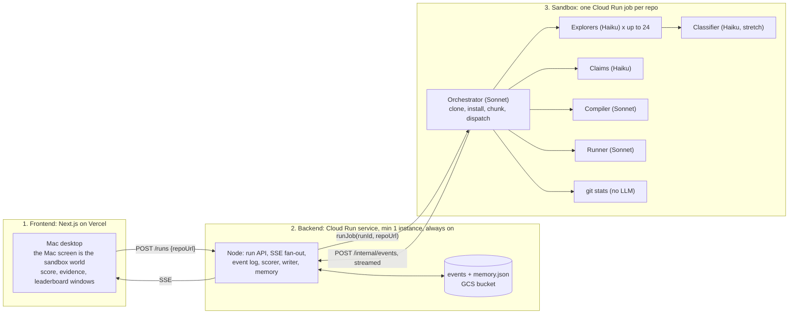

# README vs Reality: a technical due-diligence score out of 100

Moonfire Build Night, Thu 22 Oct 2026, 5 to 8pm, showcase 8:15. Sparkles Cloud Crew track, built on Google Cloud. Team: Bergen, Allen, Akshay.

Paste a GitHub URL. A crew clones it into a sandbox, splits the codebase into chunks, explores every chunk with a cheap fast agent, compiles it, runs it, checks what the README claims against what was delivered, and returns a score out of 100 with the evidence behind every point: file, line, quote. A leaderboard shows who wrote what. On screen, inside a little Macintosh, you watch the agents spawn and work.

**Pitch line:** "Every README is a pitch deck. We read the code, built it, ran it, and scored it."

## Specs
| Spec | Owner | What it covers |
|---|---|---|
| [00-contract.md](specs/00-contract.md) | all | run API, event types, finding and claim shapes, rubric, env, models |
| [01-frontend.md](specs/01-frontend.md) | Bergen | Mac desktop, the Mac screen world, avatars, score, evidence, leaderboard, fixture |
| [02-backend.md](specs/02-backend.md) | Allen | A1 run API and SSE, A2 scorer, writer and memory, A3 glue |
| [03-agents.md](specs/03-agents.md) | Allen | A3 orchestrator and chunking, A4 explorers and claims, A5 classifier |
| [04-sandbox.md](specs/04-sandbox.md) | Akshay | K1 project, K2 image and job, K3 compile, run and git agents, K4 deploys, K5 demo repos, K6 screenshot |

Avatars and the Mac frame: `assets/avatars/`. Google Cloud notes: `docs/google-cloud.md`. The thinking behind "loop on our side, sandboxes disposable": `docs/learnings-always-on-agents.md`.

## Tiers
- **Core (must):** sandbox per repo, orchestrator sets it up, chunked explorers, rubric score with quoted evidence, README delivered-vs-claimed, compile agent, run agent, the Mac screen with avatars on a treemap.
- **Stretch (core green by 7:00):** contributor leaderboard, classifier pass, per-type run agent polish.
- **Cherry (stretch green by 7:20):** screenshot of the running app as the world the avatars fly over.

Anything not done by 7:30 is named in the pitch as next, not faked.

## The three parts

One container per run, agents inside it, events streamed out as they happen so the screen moves while the job runs. The backend holds every run and computes the score; the container holds nothing after it exits. Close every laptop and the Cloud Run service keeps serving the run.

## Work split
| | Chunks, in order | Done means |
|---|---|---|
| **Bergen** | B1 scaffold, Vercel, fixture, reducer · B2 desktop and the Mac with treemap · B3 avatars, bubbles, score dial, evidence · B4 claims tab, report, presence, tokens, stage mode · B5 leaderboard, screenshot world · pitch | Fixture animates on phones by 6:15. Real run by 7:00. Pitch rehearsed twice. |
| **Allen** | A1 run API, SSE, event log, mock runner · A2 scorer, validator, writer, memory · A3 orchestrator and chunking · A4 explorers and claims · A5 classifier | Fixture streams by 5:45. Agents emit from a local run by 6:00. Real score by 6:45. |
| **Akshay** | K1 project, secrets, bucket · K2 image, job, stub round-trip · K3 compiler, runner, git stats · K4 deploy backend, wire Vercel · K5 demo repos · K6 screenshot | Stub events round-trip by 6:00. Backend on Cloud Run by 6:30. Three demo repos green by 7:00. |

Pull before you start a chunk, push when it works. `specs/00-contract.md` is the only shared surface; change it and tell the other two.

## Timeline (shift by one hour if hacking starts at 6)
- 5:00 K1 and K2 stub. A1. B1.
- 5:45 Fixture streams through Allen's local backend to Bergen's UI. First integration.
- 6:00 Stub job events round-trip from Cloud Run. Orchestrator emits from a local run.
- 6:30 Backend on Cloud Run, Vercel pointed at it. First real score.
- 7:00 Three demo repos green. Stretch decision.
- 7:20 Cherry decision.
- 7:30 Code freeze. Rehearse twice. Record the cleanest run.
- 7:45 Start the showcase run so it is live by 8:15.

## Demo (2:30)
- 0:00 "Every README is a pitch deck." Someone in the room names a repo. QR on the sticky note.
- 0:20 The Mac boots. Orchestrator appears, clones, installs. The treemap of the repo draws itself on its screen.
- 0:40 Explorers spawn and fly to their chunks. Speech bubbles: "dead export, src/utils/legacy.ts:14".
- 1:10 Compiler: "builds in 41s, 2.3MB, 3 warnings". Runner: "tests 38 of 41". Claims: "9 of 12 delivered, 2 partial".
- 1:40 Score dial lands on 67. Tap "Claims": the three missing features, README lines quoted.
- 2:00 Leaderboard: who wrote the best chunk and who wrote the dead code. Close the laptop. Phones keep updating.
- 2:20 "A VC pays an associate two days for this. The crew did it in four minutes for 40p."

## Edge cases, decided
- Huge repo: churn-ranked top 24 chunks, rest marked sampled, score shows coverage.
- Install needs secrets or Docker: install marked blocked, Runs and Compiles score from what could be done, a finding says why.
- No tests, no build system: those dimensions score their floor with a note, not zero.
- Multi-language: profile lists all, compile and run use the dominant one.
- Fork or squashed history: leaderboard shows "history truncated" or "fork" instead of a bad ranking.
- Explorer cites a file that does not exist: backend drops the finding against `repo.profile.files`.
- Sandbox times out at 10 min: backend scores whatever landed, marks the run partial.
- Rate limit with 24 Haiku explorers: 8 in flight, the orchestrator queues the rest.

## Models
Sonnet 5.5 for the orchestrator, compiler, runner and writer. Haiku 5.5 for explorers, claims and classifier: fast and cheap is the point with 24 chunks in flight. The very fast hosts (Groq, Cerebras) do not serve Claude. Gemini on Vertex only if someone has spare time for a second-opinion reviewer.

## Risks
- Install fails on the demo repo: three pre-tested repos pinned by sha, fixture as last resort.
- The score feels made up: every point traces to a finding on screen, and the pitch says so once.
- The Mac screen eats Bergen's evening: fixture first, treemap before avatars, animation last.
- Job cold start is slow: K2 measures it at 5:20; if over 60s, start the showcase run at 7:45 and let it land live.
- Lab account dies at 48h: every command lives in `infra/`.
- Rules on pre-built code: everything written tonight except fixture data and the avatar art. Confirm at 5:00.

## Judges
- Mike Arpaia (Moonfire, osquery): untrusted code in a disposable container, parallel agents, a computed score, no prompt chain.
- Adriaan Engelbrecht (Anthropic): every point traces to file, line, quote; classifier catches bad findings; README treated as data.
- Sagar Gupta (Anthropic VC): the associate's two days, done in minutes, with a leaderboard a VC would actually use.
- Kimoon Kim (Google Cloud): Cloud Run service plus jobs, event replay from GCS, Firestore and durable workflows named as the production path.
