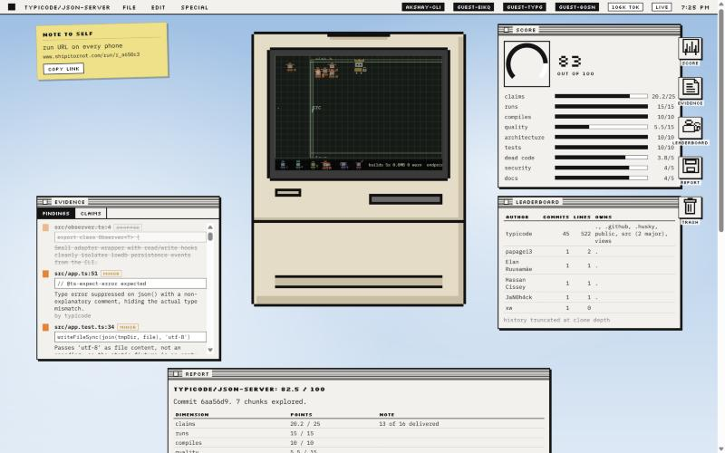
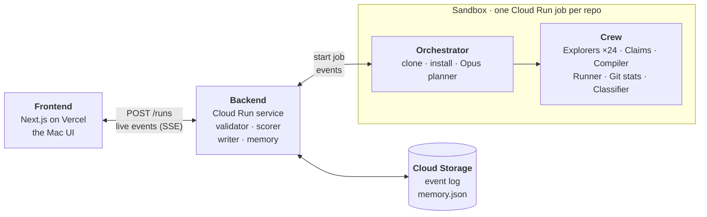

<div align="center">

<h1>README vs Reality</h1>

<b>Every README is a pitch deck. We read the code, built it, ran it, and scored it.</b>

[](https://shipitornot.com)
[](#architecture)
[](#the-crew)
[](frontend/)
[](#team)

Paste a GitHub URL. A crew of AI agents clones it into a throwaway Google Cloud sandbox,<br>
builds it, runs it, checks every promise in its README, and returns a score out of 100.<br>
Every point traces back to a file, a line and a quote.

**[Try it on shipitornot.com](https://shipitornot.com)** · [Pitch](https://shipitornot.com/pitch) · [Benchmark](https://shipitornot.com/bench) · [Recorded demo](https://shipitornot.com/run/demo) · [A real run](https://shipitornot.com/run/r_a650c3) · [Demo script](DEMO.md)

<br>

<a href="https://shipitornot.com/run/r_a650c3"></a>

<sub>A real run on <code>typicode/json-server</code>. The agents work inside the Mac, over a map of the repo. Each finding names who wrote the line.</sub>

</div>

<br>

| ⏱ 1 to 2 min | 🤖 up to 24 agents at once | 💷 £0.03 to £0.11 a run | 🧾 0 scores written by a model |
|:---:|:---:|:---:|:---:|
| from URL to report | 8 in flight, one sandbox per repo | measured on the runs below | the backend computes every point |

## Why

A VC gets a repo and a README full of claims, and an associate spends two days finding out what was really shipped. Hiring managers and acquirers have the same problem. In the AI age, plausible code is cheap, so reading the README tells you very little.

README vs Reality does that diligence in a couple of minutes. You don't get a vibe, you get a score built from evidence you can click.

**Why not just hand the repo to an agent?** Three things a chat cannot do:

- **Comparable.** One rubric, computed by code, so every repo lands on the same scale. A chat gives a different essay each time.
- **Verifiable.** The crew built it and ran it in a sandbox, and every point is a file, a line and a verbatim quote. A chat read the README.
- **Compounds.** Every run writes memory and lands on the benchmark, so the thousandth repo scores faster, cheaper, and against a percentile of everything before it. A chat forgets.

## How a run works

1. **A sandbox boots.** The backend starts one Cloud Run job execution for the repo. The first event arrives about 11 seconds later.
2. **The lead plans.** The orchestrator clones the repo and installs its dependencies. An Opus 5.5 planner splits the code by responsibility, gives each chunk a focus, and skips vendored code and fixtures.
3. **The crew fans out.** Explorers read one chunk each and report findings as `file:line` plus a verbatim quote. In parallel, the claims agent checks every README promise against the code, the compiler builds the repo, the runner runs the tests or starts the server and calls the documented endpoints, and git stats blames every file.
4. **Weak evidence is dropped, in public.** A finding is thrown out if its file isn't in the repo, if its quote isn't in the file, or if the classifier disagrees with it.
5. **The backend scores.** No agent is ever asked for a number. A fixed rubric turns the evidence into points, and a writer turns them into a report with a file cited in every sentence.
6. **Everyone watches live.** Events stream over SSE to every open browser. If you close the laptop, the run keeps going and phones keep updating.

## Architecture



- **Sandboxes are disposable.** Untrusted code only runs inside a job container that keeps nothing after it exits. The loop and the state live in the backend.
- **Nothing is lost.** Every event is appended to Cloud Storage, so a backend restart replays every run.
- **The crew learns.** Memory keeps findings the classifier overruled, so later explorers don't repeat them. Install commands are fixed per package manager and never learned from a sandbox, since sandboxes run untrusted code. A repo at a commit we've already scored is answered from memory.

## The crew

| Agent | Model | What it does |
|---|---|---|
| Orchestrator | Opus 5.5 planner | clones, profiles, installs, splits the repo into focused chunks, dispatches the crew |
| Explorer ×24 | Haiku 5.5 | reads one chunk with read-only tools and reports up to 12 findings, each with a verbatim quote |
| Claims | Haiku 5.5 | turns README promises into claims and marks each delivered, partial or missing, with evidence |
| Compiler | Sonnet 5.5 + Bash | finds and runs the build, measures size and warnings, falls back to a known command if the model stalls |
| Runner | Sonnet 5.5 + Bash | runs the tests and the README example, or starts the server and calls the routes the README documents |
| Git stats | no LLM | shortlog and blame for the leaderboard, plus the author of every flagged line |
| Classifier | Haiku 5.5 | second opinion on every finding, drops the ones the quote doesn't support |
| Writer | Sonnet 5.5 | the report, one sentence per dimension, each citing a file |

## The score

| Dimension | Points | How it's earned |
|---|---:|---|
| Claims | 25 | 15 × share of README claims delivered, plus 10 × evidence quality |
| Runs | 15 | 5 for starting, plus 10 × test pass rate or share of endpoints answering |
| Compiles | 10 | 7 for a clean build, 3 for zero warnings |
| Quality | 15 | starts full: −2 per major finding, −0.5 per minor, +0.5 per good one |
| Architecture | 10 | same rule, for architecture findings |
| Tests | 10 | 4 for having test files, plus 6 × pass rate |
| Dead code | 5 | −1 per major, −0.25 per minor |
| Security | 5 | −2 per major, −0.5 per minor |
| Docs | 5 | −1 per major, −0.25 per minor |

A repo with no build system still gets 5 of 10 on compiles, and one with no tests gets 3 of the 10 test points on runs, each with a note. When a big repo is sampled, the finding-based dimensions scale by the share of code covered. The exact formulas are in [specs/00-contract.md](specs/00-contract.md#rubric-backend-computes-sandbox-never-sends-a-score).

## Real runs on Google Cloud

| Repo | Score | Kind | Cost | What the crew found |
|---|:---:|:---:|:---:|---|
| [**typicode/json-server**](https://shipitornot.com/run/r_a650c3)<br><sub>tag v1.0.0-beta.3</sub> | **82.5** | api | £0.06 | 6 of 6 README endpoints answer, 80/80 tests pass, clean build (24 KB, 0 warnings). 13 of 16 claims delivered and 3 partial: `PATCH /profile` writes `{ item, ...body }` instead of merging into the stored object, and a POSTed numeric id breaks the "ids are always strings" promise. 14 findings name the author of the line. |
| [**un33k/python-slugify**](https://shipitornot.com/run/r_7465c6)<br><sub>planned by Opus 5.5</sub> | **78.1** | lib | £0.07 | 133/133 tests pass (5 skipped) and the README quickstart exits 0. 20 of 20 claims delivered. The planner sampled 4 of 7 chunks. |
| [**ErickKS/vite-deploy**](https://shipitornot.com/run/r_bd84c4) | **67.4** | web | £0.03 | The dev server answers and the build is 151 KB, but there are no tests. 6 of 9 claims delivered. |

The pinned commits, setup timings and earlier runs are in [infra/demo-repos.md](infra/demo-repos.md).

## Benchmark

[shipitornot.com/bench](https://shipitornot.com/bench) reads every run on the backend and refreshes every ten seconds: a score histogram, mean and p90, where repos lose points by dimension, a ranked table with each repo's percentile and weakest dimension, and the money spent. The bulk window queues repos from [infra/bench-repos.json](infra/bench-repos.json), a curated spread of 100 public repos across four languages: 30 tiny and unknown, 40 mid, 30 famous but small enough to install in minutes. It asks twice before spending anything.

## Autonomy, disclosed

**Autonomous:** everything after the URL. Clone, install, planning, exploration, build, tests, claims, blame, classification, scoring and the report all happen without anyone approving a step.

**Human:** someone pastes the URL, we picked the demo repos in advance, and [`/run/demo`](https://shipitornot.com/run/demo) replays a recorded run as a fallback.

## Try it

**On the site, no login.** [shipitornot.com](https://shipitornot.com) plays recorded runs only: the [demo](https://shipitornot.com/run/demo), the recorded real runs and the [benchmark](https://shipitornot.com/bench) are open to anyone. Pasting a repo we have recorded opens its run; any other repo points you here. A click on the public site never starts a sandbox or calls a model.

**On your laptop, no keys, no cloud, no cost.** Node 22.18 or later.

```bash
git clone https://github.com/brgmry/readme-vs-reality && cd readme-vs-reality
npm install
npm run demo      # frontend on :3000, fixture backend on :4000
```

Open http://localhost:3000 and paste any GitHub URL: the fixture backend replays a recorded run under it, labelled "recorded". Ports taken? `WEB_PORT=3100 API_PORT=4100 npm run demo`.

## Run it for real

**Real agents on your laptop, optional.** Bring your own `ANTHROPIC_API_KEY` (you pay for your runs) and Python 3.12.

```bash
pip install -r sandbox/requirements.txt
cd backend && npm install && RUNNER=local npm start   # :8080, one sandbox/main.py per run
```

**On Google Cloud.** Every command is a script in `infra/`.

```bash
source infra/env.sh
bash infra/k1.sh       # APIs, Artifact Registry, bucket, secrets
bash infra/k2.sh       # build the sandbox image with Cloud Build, create the job
bash infra/deploy.sh   # deploy the backend service, point the job at it
bash infra/run-repo.sh https://github.com/un33k/python-slugify   # start a run, stream its events
```

## Repo layout

```
frontend/           Next.js app: Mac desktop, run screen, pitch page, benchmark page, demo mode
packages/contract/  shared event types and reducer
backend/            Hono API on Cloud Run: runs, SSE, validator, scorer, writer, memory, key pool
sandbox/            the Python crew that runs inside the job
infra/              Google Cloud scripts, sandbox image, demo repos, the 100 benchmark repos
specs/              the event contract and one spec per owner
comms/              the status log the three of us kept during the build
assets/avatars/     pixel sprites and the Mac frame
```

## Team

Built in one evening at **Moonfire Build Night**, London, 22 October 2026, for the Sparkles *Cloud Crew* track.

| Who | Built |
|---|---|
| **Bergen** | the frontend, the Mac world, the shared contract, the benchmark page, the pixel crew and the pitch |
| **Allen** | the backend, orchestrator, planner, explorers, claims, classifier and scoring |
| **Akshay** | the Google Cloud setup, sandbox image and jobs, the compile, run and git agents, and the demo repos |

[Plan](PLAN.md) · [Specs](specs/) · [Demo script](DEMO.md)
